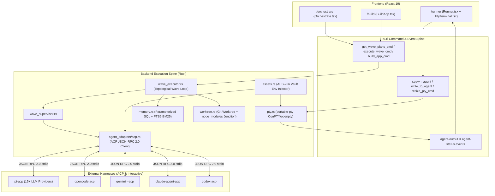

# Plan 002 — ACP Execution Spine, Real PTY Runner & Topological Wave DAG

**Spec:** `spec.md` · **BDD Scenarios:** `bdd-scenarios.md` · **Constitution:** `docs/sdlc/constitution.md`  
**ADR:** [0003 ACP Universal Harness Transport](../../adr/0003-acp-universal-harness-transport.md)  
**GitHub Issues:** #19, #20, #21, #22, #23, #24

---

## 1. Approach

1. **Milestone 1 — Interactive PTY Runner Spine & IPC Fix (Issue #19 · R101–R104):**
   - Fix the `spawn_agent` IPC mismatch between `src/stores/agentStore.ts` and `src-tauri/src/commands.rs`, and add `resize_pty_cmd`.
   - Upgrade `src-tauri/src/pty.rs` from `tokio::process::Command` piped stdio to `portable-pty` (`ConPTY` on Windows, `openpty` on Unix) so interactive TUI agents (`claude`, `opencode`, `aider`, `gemini`, `codex`) run in a real pseudo-terminal.
   - Wire `PtyManager`'s stdout/PTY reader to emit `agent-output` and `agent-status` events via `src-tauri/src/agent_events.rs`, and wire `src/components/terminal/PtyTerminal.tsx` to subscribe to `agent-output` and forward `terminal.onData` keystrokes to `write_to_agent`.
   - Replace hardcoded `'/projects/current'` in `AgentPanel.tsx` and the 3-agent stub list in `Runner.tsx` with `currentProject.path` and `AGENT_CONFIGS`, and wire all action buttons.

2. **Milestone 2 — Universal ACP Adapter & Multi-Provider Vault Injection (Issue #20 · R201–R204):**
   - Add `src-tauri/src/agent_adapters/acp.rs` implementing `AgentAdapter` over **Agent Client Protocol (ACP)** JSON-RPC 2.0 (`stdio`).
   - Support the complete ACP lifecycle (`initialize` → `session/new` with `cwd` and workspace `mcpServers` → `session/prompt` → `session/update` streaming & cost telemetry → worktree-jailed `session/request_permission` and `fs/*` → `session/cancel`).
   - Register 5 harness profiles (`pi`, `opencode`, `gemini`, `claude`, `codex`) in `AdapterRegistry` and inject decrypted API keys from `vault_entries` (`src-tauri/src/assets.rs`) into the child environment.
   - Auto-synthesize a schema-valid 6-section `HANDOFF_<id>.md` on clean ACP turn completion when the agent modified files in the worktree but did not write the markdown file manually.

3. **Milestone 3 — Topological Wave DAG Executor, Worktree Junctions & Flexible Spec Parser (Issues #21, #22 · R301–R304, R401):**
   - Add DAG cycle and wave-order validation to `src-tauri/src/orchestrator.rs`.
   - Refactor `src-tauri/src/wave_executor.rs::execute_wave_with_adapters` to group `plan_agents` by topological wave tier (`wave = 1`, `wave = 2`, …). For each wave tier: create worktrees (with automatic `node_modules` directory junction/symlink in `worktree.rs`), run the supervisor until all wave agents complete or fail, verify and merge completed worktrees into the base branch, and only then spawn the next wave tier.
   - Add `get_wave_plans_cmd` and wire `src/pages/Orchestrate.tsx` with working **Execute Wave Plan**, **Cancel**, and **Verify & Finalize** buttons.
   - Extend `src-tauri/src/spec_parser.rs` with `parse_spec_or_prompt` so freeform markdown PRDs (headings/bullet lists) and prompts decompose into `Vec<SpecTask>` when `## Phase N` / `### Step X.Y` headers are absent.

4. **Milestone 4 — Memory Layer SQL Fix, FTS5 BM25, Context Injection & UI Consolidation (Issues #23, #24 · R501–R503, R601):**
   - Replace all `format!` SQL queries in `src-tauri/src/memory.rs` with parameterized `rusqlite::params!` queries.
   - Add migration `023_memory_fts5.sql` (`memory_facts_fts` virtual table + sync triggers) and update `memory::hybrid_search` to use FTS5 `bm25()`.
   - Update `guideline_spawn.rs` / `wave_executor.rs` to inject top project memory facts and stack anti-pattern preflight warnings into `.acc/GUIDELINE.md`.
   - Consolidate sidebar navigation into the 4 core groups and gate speculative panels behind `settingsStore.experimentalFeatures` (off by default).

---

## 2. Rejected Alternatives

- *Write 9 separate CLI flag parsers and stdout regex scrapers for Claude, Pi, Gemini, Codex, Goose, Aider, etc.* — Violates Constitution §1 (Simplicity) and §2 (Anti-Abstraction). CLI flags and human TUI output change frequently across versions, whereas ACP is a versioned JSON-RPC 2.0 protocol supported natively or via official bridges across all major 2026 harnesses.
- *Keep `tokio::process::Command` piped stdio for `/runner` terminals* — Fails `isatty()` checks in modern TUI agents (`claude`, `opencode`, `aider`), causing them to refuse interactive mode or strip ANSI control sequences.
- *Spawn all waves' worktrees upfront before Wave 1 runs* — Causes Wave 2 agents to branch off `HEAD` *before* Wave 1's deliverables exist, guaranteeing merge conflicts and missing dependencies for Wave 2 agents.
- *Add external vector DB / ONNX binary blobs to fix `memory.rs` search* — Violates Constitution §1 (Simplicity); SQLite's built-in FTS5 (already compiled in `rusqlite` `bundled`) provides fast, zero-dependency BM25 ranking in-process.

---

## 3. Architecture Deltas

---

## 4. Risks & Mitigations

| Risk | Severity | Mitigation |
|---|---|---|
| Windows `.cmd` shim resolution for npm-installed ACP binaries (`pi-acp`, `claude-agent-acp`, `opencode`) | High | Reuse proven Windows resolution (`cmd /C <binary>` with zero user/task text on the command line; all prompts travel over JSON-RPC `stdin`, eliminating command-line injection). |
| ACP agent hangs waiting for an unhandled client method | High | `AcpAgentAdapter` responds to unknown JSON-RPC methods with a standard JSON-RPC `-32601 Method not found` error response rather than dropping the message, and `wave_supervisor` enforces `deadline_secs` + `cost_cap_usd`. |
| Windows directory junction creation fails if target path is relative | Medium | Canonicalize `base_repo/node_modules` and `worktree_path/node_modules` to absolute paths before creating the junction/symlink; degrade gracefully with a warning if permission is denied. |
| SQLite FTS5 syntax error when user search query contains punctuation (e.g., `"don't"` or `"c++"`) | Medium | Sanitize FTS5 query tokens by quoting each alphanumeric term as `"term"` before passing to `MATCH`. |

---

## 5. Milestones (Each Independently Shippable, All Gates Green)

- **M1 — Interactive PTY Runner Spine & IPC Repair (Issue #19):** `R101–R104`, Tasks `T1–T10`.
- **M2 — Universal ACP Adapter & Multi-Provider Vault Integration (Issue #20):** `R201–R204`, Tasks `T11–T20`.
- **M3 — Topological Wave DAG Execution, Worktree Junctions & Freeform Spec Parser (Issues #21, #22):** `R301–R304, R401`, Tasks `T21–T28`.
- **M4 — Memory SQL Safety, FTS5 BM25, Context Injection & 4-Surface UI Consolidation (Issues #23, #24):** `R501–R503, R601`, Tasks `T29–T36`.
